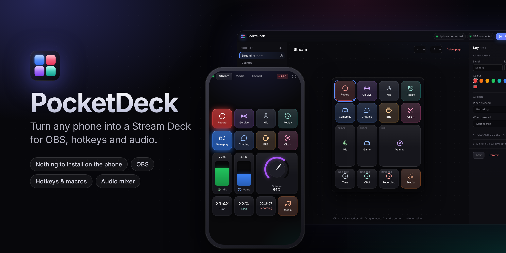
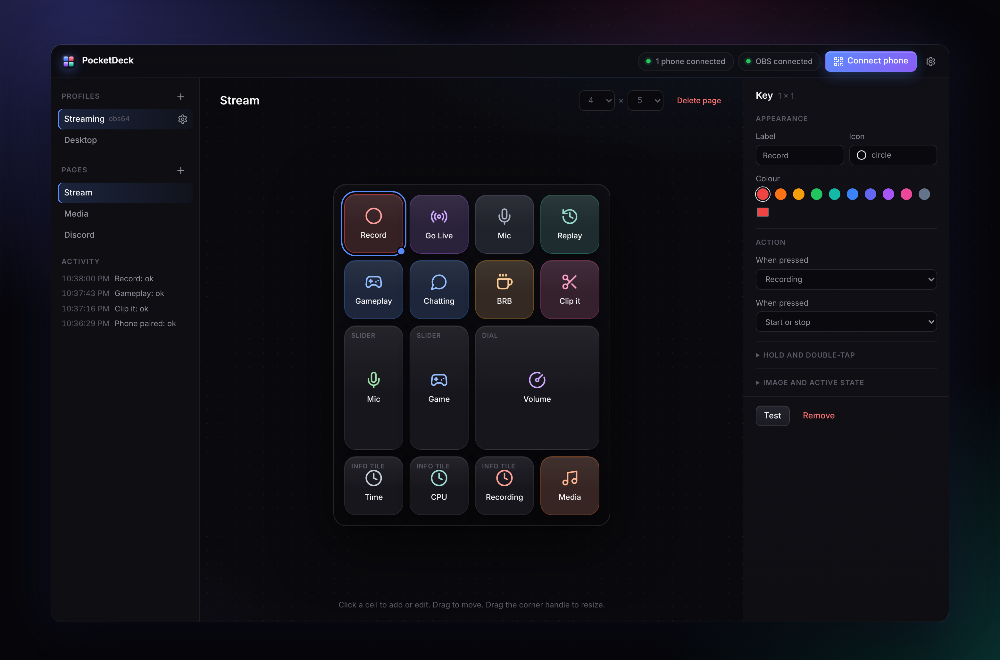
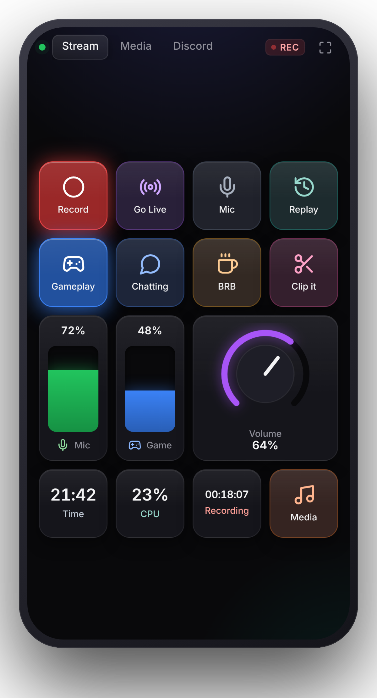
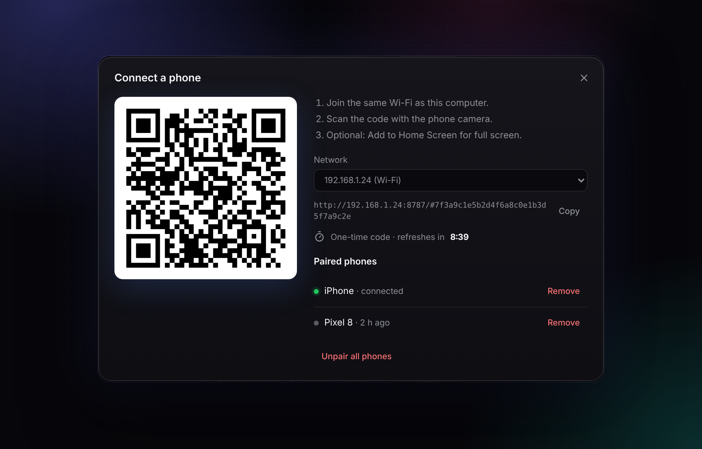
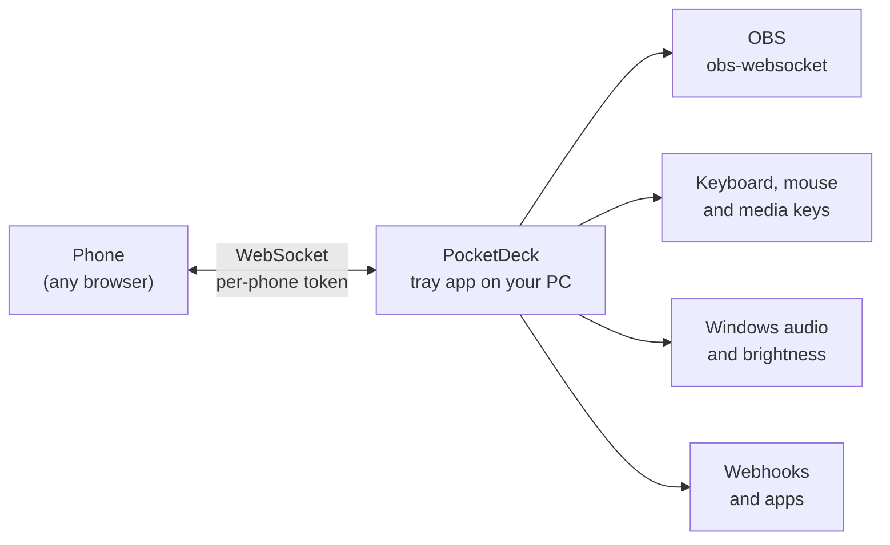

<div align="center">



<br>

**Turn any phone into a Stream Deck for OBS, hotkeys and audio.**<br>
Nothing to install on the phone. Scan a QR code and the deck opens in the browser.

<br>

[](https://github.com/KevinPratap/TechDeck/actions/workflows/ci.yml)
[](https://github.com/KevinPratap/TechDeck/releases/latest)
[](https://github.com/KevinPratap/TechDeck/releases)
[](#install)
[](LICENSE)

[**Download**](https://github.com/KevinPratap/TechDeck/releases/latest) ·
[Features](#features) ·
[How it works](#how-it-works) ·
[Security](#security) ·
[FAQ](#faq) ·
[Development](#development)

</div>

---

## Why PocketDeck

A hardware Stream Deck is great until you want a second one, or you are away from your desk, or you just have a phone in your pocket. PocketDeck runs on your PC, serves a small web app over your Wi-Fi, and any phone that scans the QR code becomes a deck: keys, sliders, dials, live info tiles and a trackpad, all wired to OBS, your keyboard and your audio.

<table>
  <tr>
    <td width="68%"></td>
    <td width="32%"></td>
  </tr>
  <tr>
    <td align="center"><sub>Design your deck on the PC: drag, resize and tweak every key.</sub></td>
    <td align="center"><sub>Use it on the phone, with live values and OBS state.</sub></td>
  </tr>
</table>

## Features

| | |
| --- | --- |
| **Keys** | Tap, hold and double-tap actions, icons or your own images, and a lit-up state that follows OBS (recording, live, active scene, muted). |
| **Sliders and dials** | System volume, per-app volume, screen brightness and OBS audio levels. They follow changes made on the PC, so they never lie. |
| **Info tiles** | Clock, recording and stream timers, OBS FPS, CPU and memory, or a countdown. |
| **Trackpad** | Move the mouse, click and scroll from the phone. |
| **Profiles** | Switch deck automatically with the program in front, chosen per phone. OBS in front? Streaming deck. Discord? Chat deck. |
| **Actions** | OBS scenes, recording, streaming, mute, sources, filters, replay buffer, virtual camera, studio mode and chapters. Hotkeys (including push-to-talk), media keys, typing text, opening apps and links, sounds on any output device, web requests, and multi-step macros. |
| **Private by design** | Everything stays on your network. Every phone pairs with its own revocable key. [Details](#security) |

## Install

1. Download `PocketDeck-Setup-<version>.exe` from the [latest release](https://github.com/KevinPratap/TechDeck/releases/latest) and run it.
2. Windows asks whether to allow PocketDeck on the network. Choose **private networks**.
3. PocketDeck starts with Windows and lives in the system tray. Closing the window keeps phones connected.

> The installer is not code-signed yet, so Windows SmartScreen may say "unknown publisher". Choose **More info → Run anyway**. You can also build it yourself from source, see [Development](#development).

## Connect a phone



1. Put the phone on the same Wi-Fi as the PC.
2. In PocketDeck click **Connect phone** and scan the QR code with the camera.
3. On iPhone use **Share → Add to Home Screen** for full screen. On Android use the full-screen button.

Each QR code works **once** and expires after 10 minutes; PocketDeck shows a fresh one by itself. Every phone gets its own secret, so you can remove a single phone under **Paired phones**, or **Unpair all phones** to disconnect everyone.

<br clear="right">

## OBS

PocketDeck uses the WebSocket server built into OBS 28 and later. In OBS open **Tools → WebSocket Server Settings**, enable the server, then copy the password from **Show Connect Info** into PocketDeck's settings.

## How it works



The desktop app is a small Electron program that runs an HTTP and WebSocket server. The phone loads a static web app from it and sends taps over the WebSocket; the PC runs the action and pushes state back (active keys, slider values, timers). Nothing leaves your network. More in [docs/ARCHITECTURE.md](docs/ARCHITECTURE.md).

## Security

PocketDeck lets a paired phone press keys and open programs on your PC, so pairing is built to be hard to abuse:

- **One-time QR codes** that expire after 10 minutes.
- **A separate secret per phone**, stored only as a hash on the PC, removable at any time, and cut off immediately when removed.
- **The OBS password is encrypted** with your Windows account.
- Connections from other websites are refused, pairing attempts are rate limited, and every message from a phone is validated and throttled.

The connection is plain HTTP on your local network, so use it on networks you trust. Read [SECURITY.md](SECURITY.md) for details and how to report a problem.

## FAQ

<details>
<summary><b>Does the phone need an app?</b></summary>
No. It opens in the browser. On iPhone and Android you can add it to the Home Screen so it runs full screen.
</details>

<details>
<summary><b>Does it work away from home or over mobile data?</b></summary>
Only on the same network as the PC, on purpose. If you want remote access, use a VPN you trust, such as your own WireGuard or Tailscale, and treat the phone as being on your network.
</details>

<details>
<summary><b>Windows only?</b></summary>
Yes for now. Volume, per-app volume, brightness and focus detection use Windows APIs. The server and phone app are cross-platform, so a macOS build is possible later.
</details>

<details>
<summary><b>The phone cannot connect.</b></summary>
Check that both are on the same Wi-Fi, and that PocketDeck is allowed on <b>private</b> networks in Windows Firewall. If the PC has several adapters (VPN, virtual machines), pick the right one in the <b>Network</b> drop-down of the connect dialog. More in <a href="#troubleshooting">Troubleshooting</a>.
</details>

<details>
<summary><b>Is it free?</b></summary>
Yes. PocketDeck is MIT licensed and free to use, change and share.
</details>

## Troubleshooting

| Problem | Try |
| --- | --- |
| The phone says the code expired | The code is single-use. Open **Connect phone** again and scan the new one. |
| The phone can't reach the PC | Same Wi-Fi? Allow PocketDeck on **private** networks in Windows Firewall. Pick the right network in the **Network** drop-down if the PC has several. |
| "Port 8787 is already in use" | Another copy of PocketDeck, or another program, uses the port. Quit it and start PocketDeck again. |
| OBS shows "offline" | In OBS: Tools → WebSocket Server Settings → enable it, then copy the password into PocketDeck's settings. |
| Something else | Open `%USERPROFILE%\.pocketdeck\pocketdeck.log`. Errors are written there. |

## Development

Requires Node.js 20 or later on Windows.

```bash
npm install
npm start        # run the desktop app
npm test         # unit and integration tests
npm run lint     # ESLint
npm run dist     # build the Windows installer into dist/
```

`npm run server` runs only the phone server in a terminal, without the editor. Sound playback needs the desktop app.

Configuration, images and sounds are stored in `%USERPROFILE%\.pocketdeck`. Errors are logged to `pocketdeck.log` in the same folder (the current and one previous file are kept).

| Path | Contents |
| --- | --- |
| `desktop/main.js` | Electron entry: window, tray, IPC |
| `desktop/server.js` | HTTP and WebSocket server for phones, pairing |
| `desktop/config.js` | Config storage, migrations, validation, paired devices |
| `desktop/actions.js` | Key actions: OBS, keyboard, mouse, web requests |
| `desktop/targets.js` | Values for sliders and dials |
| `desktop/native/winaudio.ps1` | Windows audio, brightness and foreground-app helper |
| `desktop/ui/` | Editor window |
| `phone/` | The web app served to phones |
| `test/` | Tests (`node --test`) |

Pushing a tag such as `v1.2.0` makes GitHub Actions build the installer and attach it to a release. The app icon is rendered from `desktop/ui/icon.svg`.

## Roadmap

- Signed installer and automatic updates
- A light theme
- Optional HTTPS for the phone connection
- Per-phone limits on which actions a phone may run
- macOS support

Ideas and bug reports are welcome. See [CONTRIBUTING.md](CONTRIBUTING.md).

## License

[MIT](LICENSE) © Kevin Pratap Sidhu
